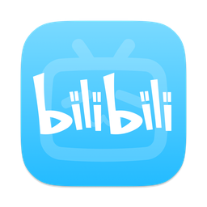
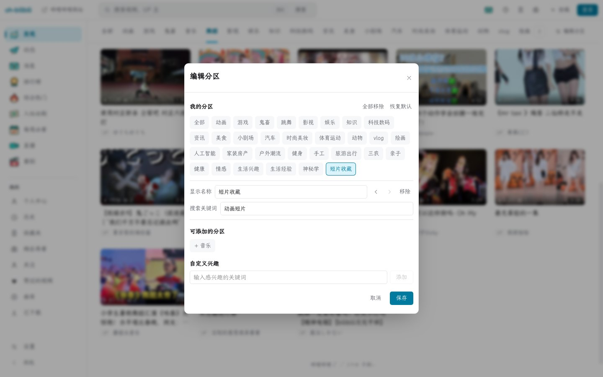

<p align="center">
  
</p>

<h1 align="center">oh-bilibili</h1>

<p align="center">把你自己的 B 站账号内容，放进一个安静的桌面窗口。</p>

<p align="center">
  
  
  
  
</p>


## 这是什么

一个开源的桌面 B 站客户端。视频和音频都走你自己的 B 站账号，本机直连，不经过中间服务器；界面按 B 站网页端的视觉语言做：浅色底、B 站蓝、封面卡片、分区贴纸、弹幕和三连。

不是内容分发服务，不绕过会员、付费或地区限制，也不做任何变现。

## 现在能做什么

### 发现

「全部」只显示 B 站首页推荐的视频，向下滚动可看下一批。选中「音乐」「舞蹈」等分区后，会显示该分区的投稿。点「编辑分区」可添加、移除、改名或调整顺序，也可以输入关键词添加自己的兴趣标签。设置保存在当前设备。直播、番剧和观看历史可从导航进入。



### 观看

DASH 播放（4K / 1080P+ / 1080P 等），断点续播、倍速、网页全屏和系统全屏，真实弹幕、进度条上方的高能密度条、弹幕显示区域 1/4 / 1/2 / 全屏。点一下点赞，长按点赞触发三连。用键盘聚焦点赞后也可以长按空格或回车。另有投币面板、收藏夹选择、分享、稍后再看和自动连播。右侧是 UP 名片、弹幕列表、合集和相关推荐；评论区带等级牌、粉丝牌、表情和 @ 用户。

多 P 作品可以从卡片目录选集，同时属于合集的作品还有独立的合集入口。带时间点的评论可以展开为笔记，点选已标明分 P 的时间会跳到对应片段。投稿人在简介里标注了原舞、原曲或素材链接时，可以查看原句和出处。


### 动态

关注 UP 的最新投稿，视频、图文九宫格、转发、专栏和直播推荐混排；分类 tab、正文话题标签、转发评论点赞统计，视频卡悬停可以直接「稍后再看」。


### 还有

- **搜索**：综合 / 视频 / UP 主，按分区、时长和排序筛选。粘贴带 BV 号的 B 站视频网址可以直接打开作品，保留链接里的分 P 和起播时间。从作品或 UP 空间返回后，回到原结果和键盘焦点。
- **榜单**：热门、每周必看、入站必刷、排行榜，以及番剧五个分类和追番列表。
- **账号**：关注列表与 UP 空间、消息中心、宽窗双栏收藏夹、历史、喜欢、稍后再看。历史页的「继续播放」会按保存的分 P 和断点续听。旧记录缺少分 P 时，先用本机观看记录，两处都没有分 P 就从 P1 的旧断点开始。收藏夹的「播放全部」会先读完整个夹。稍后再看的「连续观看」从所选视频开始，按当前筛选顺序播放，保留原听歌队列。
- **音乐** 支持播放队列、同步歌词和分 P 字幕。在观看页点「听视频」，或在听歌舞台点「看视频」，会接着当前分 P 的进度播放。已暂停的曲目切换后仍然暂停。舞台没有匹配歌词时，可从「弹幕听点」点一句观众的原话，跳到这一 P 里可见弹幕集中的片段。

## 跑起来

Windows x64 用户从 [Windows Release](https://github.com/TTAWDTT/oh-bilibili/releases/tag/v0.1.1) 下载 `oh-bilibili-0.1.1-windows-x64-setup.exe`，双击后安装到当前用户。安装包未签名。首次运行需要 Microsoft Edge WebView2 Runtime，缺少时安装程序会联网安装。Apple Silicon 用户可下载 [macOS 版本](https://github.com/TTAWDTT/oh-bilibili/releases/tag/v0.1.0)。

从源码运行需要 Node 22.12+ 和 Rust stable，终端需能运行 `cargo`。Windows 还需 Visual Studio Build Tools 的「使用 C++ 的桌面开发」工作负载、Windows SDK 和 WebView2 Runtime。

```sh
npm ci
npm run fetch:yt-dlp:windows   # Windows x64
# macOS 改为运行 sh scripts/fetch-yt-dlp.sh
npm run dev      # Tauri 桌面窗口
npm run web      # 只调界面：浏览器里跑，内存 mock，不碰真实接口
```

下载功能使用随包提供的 yt-dlp。Windows 准备命令会校验固定版本的 SHA-256。

## 打包

```sh
npm run bundle
```

Windows x64 安装程序在 `target/release/bundle/nsis/`。macOS 应用在 `target/release/bundle/macos/`。`.app` 未签名，首次打开要右键选择「打开」。生成 DMG 需要有 Finder 的图形会话。

## 架构

```
apps/desktop  React 19 + Vite + Tailwind，Tauri 命令桥
     │
     ▼
crates/core   播放队列、状态机、业务编排
crates/bili   B 站接口、WBI 签名、cookie 与解析
crates/audio  symphonia 解码 + cpal 输出
crates/store  SQLite（WAL）
crates/model  共享领域类型
```

声音不进 webview：Rust 取流、解码、输出到声卡，界面只发命令收事件。四条规矩：

1. 播放位置的真值只在声卡侧（`Clock` 原子帧计数）。
2. `bili` 的 wire 类型不出适配层。
3. 队列身份是 `EntryId`，不是下标。
4. Rust 与 TS 字段名必须一致，`crates/core/tests/contract.rs` 双向断言。

更细的接口、踩坑和实现记录见 `docs/HANDOFF.md`。

## 验证

```sh
npm run verify     # Rust 测试 + TS 类型 + 浅色主题 + IPC 注册
cargo test --workspace
npm run typecheck -w @bilimusic/desktop
```

需要网络与声卡的真实接口测试走单独入口。需要登录态的部分只读取显式指定的专用测试账号，不读取应用自己的登录态：

```sh
BILIMUSIC_LIVE_COOKIES=/path/to/cookies.json ./scripts/live-test.sh
```

未配置凭据时脚本打印 `SKIPPED` 并以 77 退出，表示没有跑过线上用例，不能记成通过；配置后会先只读验证登录，再跑两套用例，全部通过才打印 `VERIFIED`。点赞、稍后再看、收藏这类会写账号的用例跑完会把账号恢复原状。

不要直接对 `--ignored` 套件看退出码当线上结论：缺少凭据时凭据用例会明确失败，而不是把「跳过」计成 passed。

## 边界

- 音源请求从你的电脑直连 B 站，作者服务器不参与。
- 不绕过会员、付费、地区限制；下载只落本机目录。
- 凭据只存本机。写操作（点赞、投币、收藏、关注）走你自己的账号，投币不可逆。
- 登录扫码需要你本人完成，自动化不代替。

## 已知缺口

- 登录后的写操作只在真机手点验证过，没有自动化往返。
- 长时间压测只做过 60 秒内存采样和 5 次切歌，没有连续几小时的观察。
- 窄窗口可用，iOS / Android 尚未打包。
